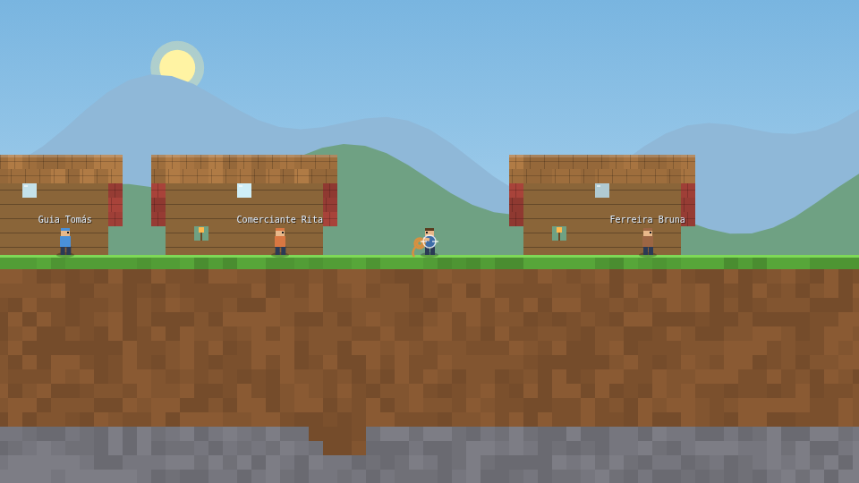
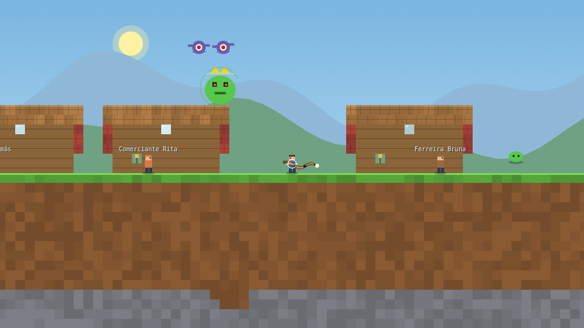
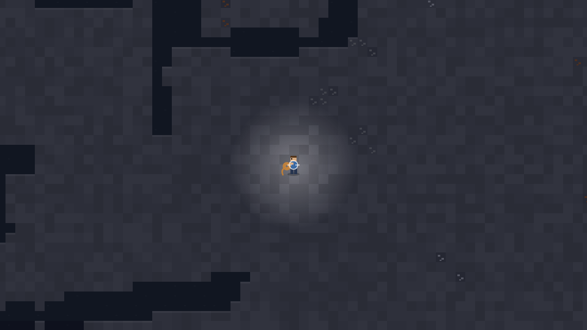
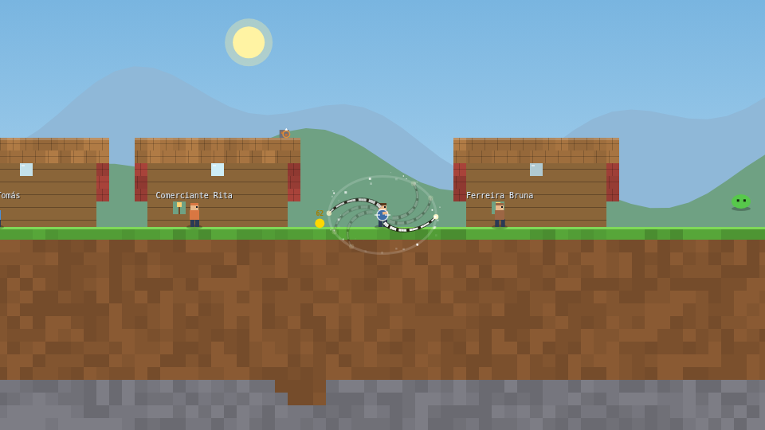

# Chicotes do Destino

O jogo de 200 espadas recriado com uma única troca estrutural: a arma.
Onde havia 200 espadas, há **200 chicotes**. O resto — mundo, mineração,
construção, criação (crafting), chefes, conquistas e interface — continua.

> *"Se funciona com espada, funciona com chicote — mas o chicote alcança mais
> longe, acerta mais de um inimigo e não corta: ele estala."*

Especificação completa (prompt de 13 páginas que gerou este jogo):
[`docs/chicotes_do_destino_prompt.pdf`](docs/chicotes_do_destino_prompt.pdf) ·
texto extraído em [`docs/especificacao-extraida.txt`](docs/especificacao-extraida.txt)
· resumo de implementação em [`docs/ESPECIFICACAO.md`](docs/ESPECIFICACAO.md).

## Jogar

Sem instalar nada — o jogo inteiro é um **único `index.html`**, sem
dependências, e roda offline:

1. Abra o arquivo **`index.html`** no navegador (clique duplo funciona), **ou**
2. sirva com o servidor local: `node serve.js` e abra http://localhost:8080,
   **ou**
3. publique no GitHub Pages servindo a raiz deste repositório (`index.html`
   já está na raiz; basta ativar o Pages apontando para a branch `main`).

## Capturas do jogo

| A vila inicial | Rei Slime (chefe nº 1) |
|---|---|
|  |  |
| **Cavernas e mineração** | **Giro de 360° com chicote Tier 10** |
|  |  |

## Os números fechados

| Conjunto | Total | Composição |
|---|---|---|
| Chicotes | **200** | 10 tiers × 20 — T1–T6 forjáveis, T7–T8 com minério de chefe, T9–T10 só caem de chefe |
| Chefes | **94** | 4 clássicos + 90 novos em 6 atos (8+14+16+12+20+20), cada um com mecânica inédita |
| Receitas | **433** | 160 chicotes + 50 armaduras + 50 barras + 5 picaretas + 5 acessórios + 30 poções + 40 blocos + 93 selos |
| Itens | **628** | catálogo completo inventariável |
| Conquistas | **429** | 200 de arma + 94 de chefe + 12 segredos `???` + 123 nas outras 7 categorias |
| Minérios / barras | 50 / 50 | 10 famílias × 5; os de pós-jogo só caem de chefe |
| Armaduras / acessórios | 50 / 50 | 45 acessórios exclusivos de chefe + 5 forjados |
| Picaretas | 5 | poder 10 a 14, destravam os minérios mais duros |

A **Apoteose**, o chicote nº 200, só existe quando o contador de chefes chega
a **94/94**.

## As 7 regras de ouro do chicote

1. **Alcance 2–3×** — corda de 3,3 blocos (T1) a 4,2 (T10), hitbox em cápsula seguindo a curva;
2. **Dano até a ponta** — `dano(t) = Base × (0,60 + 1,00 × t)`; os últimos 10% são o **estalo**: ×1,60 de novo (**2,56×** no total), sem sorteio;
3. **Vários em linha** — 3 (T1) a 8 (T10) alvos por golpe, −15% por alvo extra;
4. **Giro de 360°** — segure o golpe por 0,45s e solte: 1,2s de dano radial com empurrão;
5. **Gancho** — a ponta agarra blocos (um tipo novo por tier), puxa o jogador e recolhe drops;
6. **Par a partir do T5** — o segundo chicote golpeia alternado com 70% do dano;
7. **Corda viva** — cadeia de 12 a 24 segmentos que ondula e encosta no cenário, com som, faísca e tremor curto de tela no estalo.

O chicote **não** minera (a picareta continua sendo a ferramenta), não
bloqueia projéteis e não substitui a construção.

## Controles

| Ação | Teclado/mouse | Controle | Toque |
|---|---|---|---|
| Andar / pular | `A`/`D` ou setas · `Espaço` | direcional esquerdo · A | ◀ ▶ ▲ |
| Golpe | clique (soltar rápido) | X / RT | 💥 |
| Giro 360° | segurar o clique 0,45s e soltar | segurar X e soltar | segurar 💥 e soltar |
| Gancho | botão direito ou `F` (pular solta) | B | 🪝 |
| Mirar | mouse | direcional direito (mira analógica) | arrastar no canvas |
| Minerar / construir | selecione picareta/bloco e segure o clique | X | 💥 com arrasto |
| Falar com NPC | `E` | Y | E |
| Painéis | `I` inventário, `C` criação, `V` arsenal, `B` chefes, `M` mapa, `Esc`/`P` pausa | Start | botões na tela |
| Salvar | `Ctrl`+`S` (e automático a cada 30s) | — | pausa → Salvar |

## Progressão resumida

Na vila, fale com o **Guia Tomás** (E). Mine minérios com a picareta
(espaço 2), funda Barras em **Criação** (`C`) e forje chicotes dos próximos
tiers. Use um **Selo** da barra para invocar o **Rei Slime** e avance pelos
94 chefes em **Chefes** (`B`): os atos V e VI guardam os chicotes T9–T10 —
um por chefe — até a Apoteose final, com 4 fases.

## Mundo e save

- Mundo de **1400×480 blocos** de 16px com semente única (6 biomas,
  cavernas, veios por profundidade, lava no fundo) — dois mundos nunca são iguais;
- Save em **IndexedDB** com salvamento automático e miniatura; perfil e
  conquistas em **LocalStorage**;
- **Exportar/importar mapa** em arquivo `.json` em "Meus Mundos";
- Ciclo dia/noite, escuridão no subsolo com tochas, NPCs com balões em
  português, loja da vila, música e efeitos sintetizados em WebAudio
  (sem arquivos externos — o `serve.js` tem MIME de MP3/PDF e Range 206
  caso você adicione arquivos em `docs/`).

## Estrutura do projeto

```
index.html               ← o jogo inteiro (gerado, não edite à mão)
build.js                 ← node build.js  → valida as tabelas e gera o index.html
serve.js                 ← node serve.js  → servidor local (MIME PDF/MP3, Range 206)
src/
  00-dados.js            ← TODAS as tabelas: 200 chicotes, 94 chefes, 628 itens, 433 receitas, 429 conquistas
  10-motor.js            ← RNG com semente, IndexedDB, áudio WebAudio, ícones por código
  20-mundo.js            ← mundo 1400×480: geração com semente, biomas, física de blocos
  30-combate.js          ← as 7 mecânicas do chicote, inimigos, chefes, NPCs, conquistas
  40-interface.js        ← HUD e painéis (azul tipo Terraria mobile)
  50-jogo.js             ← estado, entrada (teclado/mouse/gamepad/toque), loop 60 fps, desenho
  style.css · index.template.html
docs/
  chicotes_do_destino_prompt.pdf   ← especificação original (prompt)
  dados-jogo.json · chicotes.csv · chefes.csv · conquistas.csv  ← tabelas exportadas pelo build
tools/verificar.js       ← confere os critérios de aceite quantitativos
```

## Desenvolver

```bash
node build.js            # concatena src/*.js no index.html único e exporta as tabelas
node tools/verificar.js  # valida 200/94/433/628/429, fórmulas, unicidade e offline
node serve.js 8080       # serve o jogo localmente
```

Critério técnico de aceite: **o build continua sendo um único arquivo**,
sem framework nem CDN — `npm install` não é necessário para jogar nem para
gerar o jogo, apenas o Node para `build.js`/`serve.js`.
